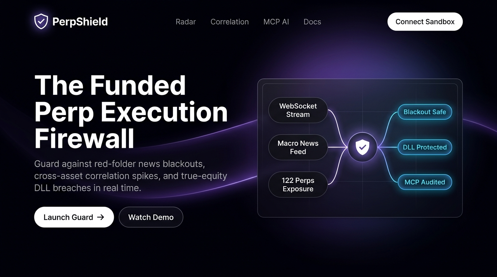
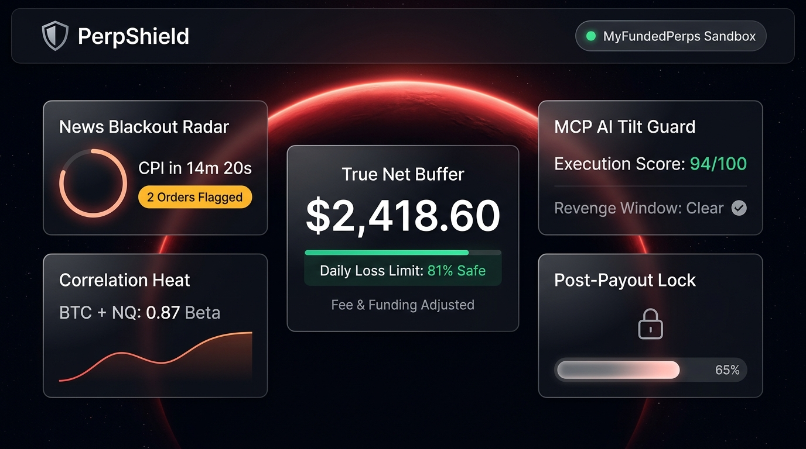

# 🛡️ PerpShield — The Funded Perp Execution Firewall

**Real-time macro news blackout radar, cross-asset correlation guard, true net-equity buffer, and MCP-powered tilt post-mortem for [MyFundedPerpetuals](https://myfundedperpetuals.com/) and multi-firm perp traders.**



---

## Why PerpShield?

Funded perpetuals traders rarely blow accounts because of bad chart reading—they blow accounts from **prop-specific structural traps**:

1. **Red-Folder News Blackout Violations (`-10m` to `+2m`):** Funded accounts forbid opening/increasing exposure 10 minutes before high-impact macro prints (CPI, NFP, FOMC) and forbid *any* manual trade (even closing) from `-2m` to `+2m`.
2. **Cross-Asset Correlation Blindness (122 Perps):** Being Long `BTCUSDT`, Long `NQ100`, and Long `ETHUSDT` feels diversified until a single macro print pushes all three past your **3% Daily Loss Limit (00:00 ET)**.
3. **Fee, Slippage & Funding P&L Illusion:** Generic trackers ignore accrued funding and venue slippage tiers, masking your true remaining buffer.
4. **Post-Payout Drawdown Lock Surprise:** Your first payout permanently locks your loss floor to your starting balance on Select/Prime/Signature plans—dramatically shrinking your safe risk-per-trade.



---

## Architecture

```text
wss://account-stream.myfundedperpetuals.com/v1/stream ──┐
Macro Economic Calendar (America/New_York ET)           ├──▶ PerpShield Engine ──▶ Webhook / CLI Alerts
https://developers.myfundedperpetuals.com/v1            ┘         │
                                                                  ▼
https://mcp.myfundedperpetuals.com (OAuth Read-Only) ──────▶ AI Tilt & Execution Scorecards
```

---

## Quickstart (Zero Dependencies, Node 22+)

```bash
git clone git@github.com:palindrome1603/PerpsShield.git
cd PerpsShield

# 1. Run the offline demo simulation (no API key required)
npm run demo

# 2. Run the unit test suite
npm test

# 3. Connect to your MyFundedPerps Sandbox (fp_test_*)
cp .env.example .env
# Add FP_API_KEY=fp_test_... to .env
npm start
```

### MCP Server Integration (Read-Only OAuth)
See [`mcp-config.example.json`](./mcp-config.example.json) to connect `https://mcp.myfundedperpetuals.com` for AI-assisted fill post-mortems and revenge-trading tilt detection.

---

## MyFundedPerps API & Builder Compliance

- **Sandbox-First:** Built and tested against `fp_test_` sandbox keys.
- **WebSockets Over Polling:** Uses `wss://account-stream.myfundedperpetuals.com/v1/stream` for real-time account & order events.
- **Idempotency:** Sends `Idempotency-Key` on all state-changing requests and reuses it across retries.
- **Rate-Limit Backoff:** Respects `429` and `503` responses with `Retry-After` sleep backoff.
- **Least Privilege:** Read-only scopes for monitoring and MCP analytics; secrets are never logged or committed.

---

## Roadmap
- [x] **v0.1 (Prototype):** WebSocket + REST client, Red-Folder News Blackout Radar (`-15m` / `-10m` / `-2m`), Cross-Asset Correlation Heat, True Net-Equity Buffer, Post-Payout Lock Simulator, Unit Tests.
- [ ] **v0.2 (Web Dashboard):** Live browser UI with OAuth read-only login and 1-click Shareable Funded Execution Scorecards for X.
- [ ] **v0.3 (Multi-Firm Profiles):** Rule adapters for additional prop perp & futures firms.

> *Independent community tool built for the MyFundedPerps Builders Program. Not official MyFundedPerpetuals software.*
